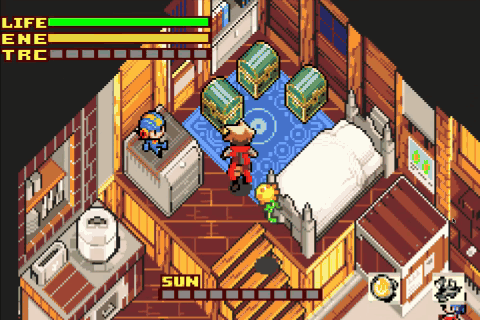
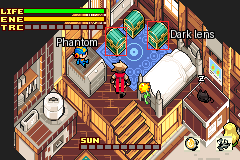
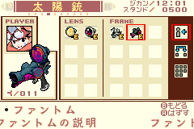

# Boktai 3: Dark Gun Patch

A patch for the Japanese *Boktai 3* (GBA) that gives Django Sabata's dark gun: the **Phantom** frame and the **dark lens**.

## Install

1. Get a clean Japanese Boktai 3 ROM (CRC32 `AF453162`).
2. Download `boktai3_dark_gun.bps` from [Releases](../../releases).
3. Apply it with [Rom Patcher JS](https://www.marcrobledo.com/RomPatcher.js/) or Flips. The result should have CRC32 `1AAA036E`.

## Use

Open the two new chests in Django's home, then equip both parts on the gun page. Hold B to charge, and release for the
dark spin. The two parts only work together.
